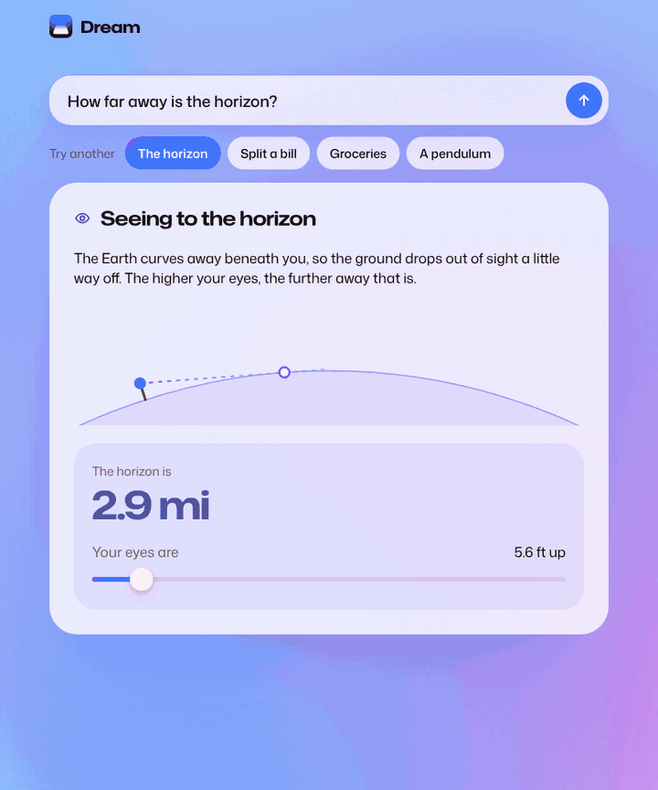
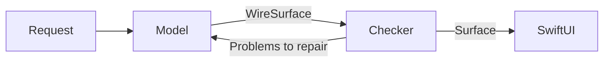

# Dream

Ask for anything, and Dream makes a page that explains it, calculates it, or both.

[Try the website](https://dream.onlychan.xyz).

Built by Chandram Dutta. Dream is an iOS app, not a chat interface. A request becomes a
page you can read, change and use again.

<!-- TODO: Record an app demo and add it at docs/media/demo.gif. -->


## A few requests

| Ask | The page |
|---|---|
| “Split a dinner bill four ways with a tip.” | A working calculator. Change the bill, tip or number of people and see each person's share. |
| “Make a grocery list.” | A list you can add to and tick off. |
| “How far away is the horizon?” | A drawing and a calculation. Change the eye height and see the distance change. |
| “Why does a pendulum swing?” | A swinging pendulum with its period. Change the length or try Earth's, the Moon's or Mars's gravity. |

## What a page can hold

Text, facts, timelines and sources. Calculations with controls and worked equations.
Charts, figures, diagrams and 3D scenes. Images, sounds and lists that keep their entries.
Live data and actions from connected services, with permission before a change is made.

## How it works

The model writes structure, not UI code. Through Foundation Models guided generation,
it writes a `WireSurface`. The checker validates formulas, controls and sources, repairs
what it can, and sends remaining problems back to the model. SwiftUI renders the checked
`Surface` as a native interface. The format, checker and renderer are hand-written.



On `main`, Dream uses Apple Intelligence: Private Cloud Compute for page generation,
with on-device models for smaller jobs and an optional on-device page writer. That writer
uses the narrower `DeviceSurface` format and the same checker and renderer. Automatic
fallback to it is off. Sign in with Apple is optional. There is no subscription.

The server handles accounts, sync, shared links, web search and reading. It does not
proxy model requests for this app. Some older roadmap and production notes still describe
the previous model proxy and subscription. See [Dream on Apple Intelligence](docs/AppleIntelligence.md)
for the current model path.

## Repository

- `Dream/` — the SwiftUI app, page engine, model harness and local storage.
- `Server/` — the Cloudflare Worker, accounts, sync, sharing and web tools.
- `Website/` — the Astro landing page and interactive demos.
- `Tools/` — Mac test runners, generation benches and device checks.
- `docs/` — architecture notes, privacy, analytics and release documentation.

## Build and test

Use a Mac with **Xcode 27 and the iOS 27 SDK**. The app targets iOS 27.
Open `Dream.xcodeproj` and select the `Dream` scheme. Configure signing for your team.

Private Cloud Compute needs the managed `com.apple.developer.private-cloud-compute`
entitlement enabled for the App ID and included in signing. Without it, build with
`DREAM_PRIVATE_CLOUD = NO` so the app never touches PCC. PCC requires a signed app;
the Mac bench can use the on-device model. See the [building notes](docs/AppleIntelligence.md#building).

Run the engine and generation tests on a Mac, without a model or network:

```sh
Tools/tests.sh
```

The script builds a macOS Swift package from the app sources and runs `DreamTests`.
The same tests are available in Xcode through Product › Test.

See [Server/README.md](Server/README.md) for the Worker and its tests, and
[Website/README.md](Website/README.md) for the site's build and preview commands.

## Status

In development. Not yet on the App Store or TestFlight.
See [ROADMAP.md](ROADMAP.md) for feature work and [PRODUCTION.md](PRODUCTION.md) for
release work. Their older model and pricing plans do not describe the current app.

[Privacy policy](https://dream.onlychan.xyz/privacy) · [Terms](https://dream.onlychan.xyz/terms)
